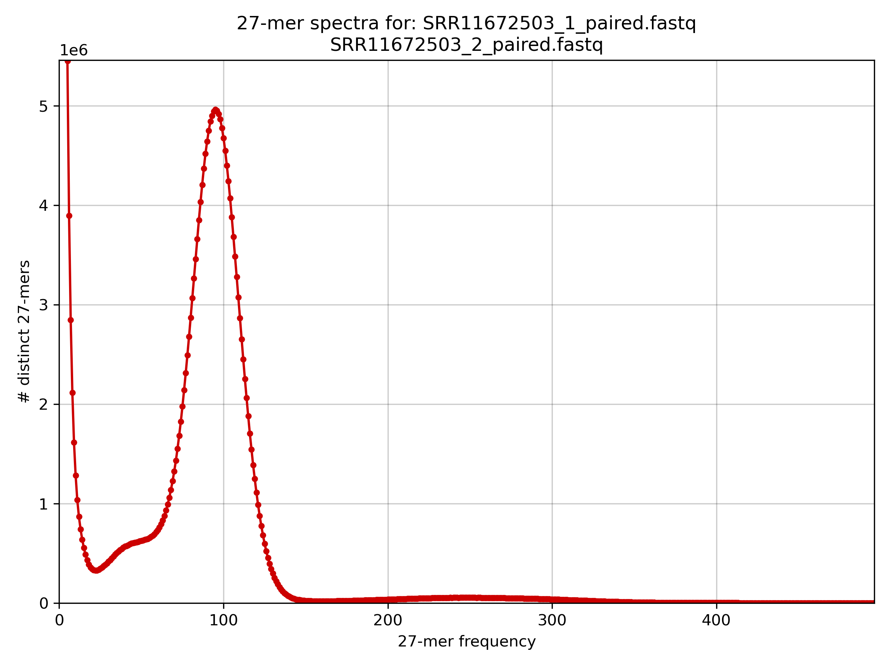

# 02_KmerBased_GenomeSurvey

- Short-read data setup
- Quality control of raw Illumina paired-end sequencing reads (*Anopheles stephensi*)
- Read trimming with Trimmomatic
- K-mer distribution analysis using KAT and GenomeScope 2.0


## 1. Data Access & Links (`ln -s`)

Instead of downloading the raw sequencing reads from the internet, we used the pre-downloaded files provided on the university server.

Raw FASTQ files are large (several gigabytes). To save disk space, we created shortcuts (links) to the shared data directory instead of copying the actual files:

```bash
# Create links to raw paired-end reads
ln -s /home/PERSONALE/mirko.martini3/Lab_CompGeno/00_practice/00_data/00_reads/SRR11672503_1.fastq.gz .
ln -s /home/PERSONALE/mirko.martini3/Lab_CompGeno/00_practice/00_data/00_reads/SRR11672503_2.fastq.gz .
```


## 2. Quality Control on Raw Reads (FastQC)

Before trimming or assembling, we evaluate base quality, adapter contamination, and duplication levels across raw sequencing reads using **FastQC**[cite: 3, 6].

*(Note: To save server time during class, we skipped running `fastqc` ourselves and copied the pre-computed HTML reports from the shared directory, then inspected them in the browser).*

```bash
# Command that would normally be run:
fastqc SRR11672503_1.fastq.gz SRR11672503_2.fastq.gz

# Copy pre-computed FastQC outputs from the shared directory
cp /home/PERSONALE/mirko.martini3/Lab_CompGeno/00_practice/02_KmerBased_GenomeSurvey/SRR11672503_1_fastqc.html .
cp /home/PERSONALE/mirko.martini3/Lab_CompGeno/00_practice/02_KmerBased_GenomeSurvey/SRR11672503_1_fastqc.zip .
cp /home/PERSONALE/mirko.martini3/Lab_CompGeno/00_practice/02_KmerBased_GenomeSurvey/SRR11672503_2_fastqc.html .
cp /home/PERSONALE/mirko.martini3/Lab_CompGeno/00_practice/02_KmerBased_GenomeSurvey/SRR11672503_2_fastqc.zip .

# Track and commit FastQC HTML reports in Git
git add SRR11672503_1_fastqc.html SRR11672503_2_fastqc.html
git commit -m "QC on raw reads"
git push
```


## 3. Read Trimming (Trimmomatic)

We remove low-quality bases and Illumina adapter sequences using a sliding-window approach in Trimmomatic. For paired-end reads, both mates belong to the same fragment—if one mate fails quality filtering, the pair is lost[cite: 3, 6].

```bash
# Activated Conda environment: assembly
conda activate assembly

# Execute Trimmomatic in Paired-End mode (using 8 threads)
trimmomatic PE -threads 8 -phred33 \
  SRR11672503_1.fastq.gz SRR11672503_2.fastq.gz \
  SRR11672503_1_paired.fastq SRR11672503_1_unpaired.fastq \
  SRR11672503_2_paired.fastq SRR11672503_2_unpaired.fastq \
  ILLUMINACLIP:/opt/miniforge3/envs/assembly/share/trimmomatic-0.40-0/adapters/TruSeq3-PE.fa:2:30:10 \
  LEADING:3 TRAILING:3 SLIDINGWINDOW:4:15 MINLEN:36 2> stats_trimmomatic.log
```

### Key Parameter Breakdown
- `PE`: Paired-end mode
- `-threads 8 -phred33`: Uses 8 CPU threads (our server uses max. 80 CPU) and Phred-33 quality encoding
- Input / Output Files (requires 6 positional file arguments):
  - **2 Inputs**: `SRR11672503_1.fastq.gz` (forward) and `SRR11672503_2.fastq.gz` (reverse)
  - **4 Outputs**: `SRR11672503_1_paired.fastq`, `SRR11672503_1_unpaired.fastq`, `SRR11672503_2_paired.fastq`, and `SRR11672503_2_unpaired.fastq`
- `LEADING:3` / `TRAILING:3`: Cuts bases at the start or end of a read if quality is below 3
- `ILLUMINACLIP`: Removes TruSeq3 paired-end adapters using the specified path
- `SLIDINGWINDOW:4:15`: Trims the read when average Phred quality drops below 15 across a 4-bp window
- `MINLEN:36`: Discards reads shorter than 36 bp after trimming


## 4. Post-Trimming Quality Control

Note: In standard bioinformatics pipelines, you re-run FastQC on trimmed reads to verify quality improvement. In our practice session, we skipped running FastQC ourselves and instead reviewed the pre-computed reports provided by the professor (`1_paired_fastqc`).

```bash
# Command that would normally be run:
fastqc SRR11672503_1_paired.fastq SRR11672503_2_paired.fastq
```
Observations: Read quality increased significantly after trimming, and most surviving reads remained at ~150 bp length.


## 5. K-mer Analysis (KAT & GenomeScope 2.0)

K-mer counting breaks sequencing reads into short substrings of length *k* (a mathematical concept to estimate genome size, repeat content, and heterozygosity) before genome assembly.

```bash
# Switch to KAT Conda environment
conda activate kat

# Calculate k-mer frequency histogram (k=27) on trimmed paired reads
kat hist -t 8 -m 27 -o anoste_27 SRR11672503_1_paired.fastq SRR11672503_2_paired.fastq
```

### Parameter Breakdown
- `-t 8`: Uses 8 CPU threads
- `-m 27`: Sets k-mer length to *k = 27* (standard choice for insect genome surveys)
- `-o anoste_27`: Output file prefix
- Inputs: `SRR11672503_1_paired.fastq` and `SRR11672503_2_paired.fastq`
- Generated Output Files: `anoste_27.hist` (histogram data) and `anoste_27.png` (k-mer plot)

### Saving and Pushing KAT Outputs
```bash
# Commit and push both the plot (.png) and histogram (.hist) to GitHub
git add anoste_27.hist anoste_27.png
git commit -m "Add KAT k-mer hist27 output"
git push
```



- Main peak (~96x k-mer coverage): Homozygous genome peak.
- Small shoulder (~48x): Low heterozygosity.

### GenomeScope 2.0 Profiling Steps
1. Open the resulting `anoste_27.hist` histogram file and remove any comment lines at the beginning.
2. Upload the cleaned histogram file to [GenomeScope 2.0](http://qb.cshl.edu/genomescope/genomescope2.0/) and watch out for lower and upper count boundaries.
3. View pre-computed analysis results at <http://genomescope.org/analysis.php?code=97ab6nlVpU3H5hDzfqAy>.
4. **Result:** Estimated haploid genome size is **~227.05 Mbp** (used later in polishing with HyPo as `-s 227054799`).
