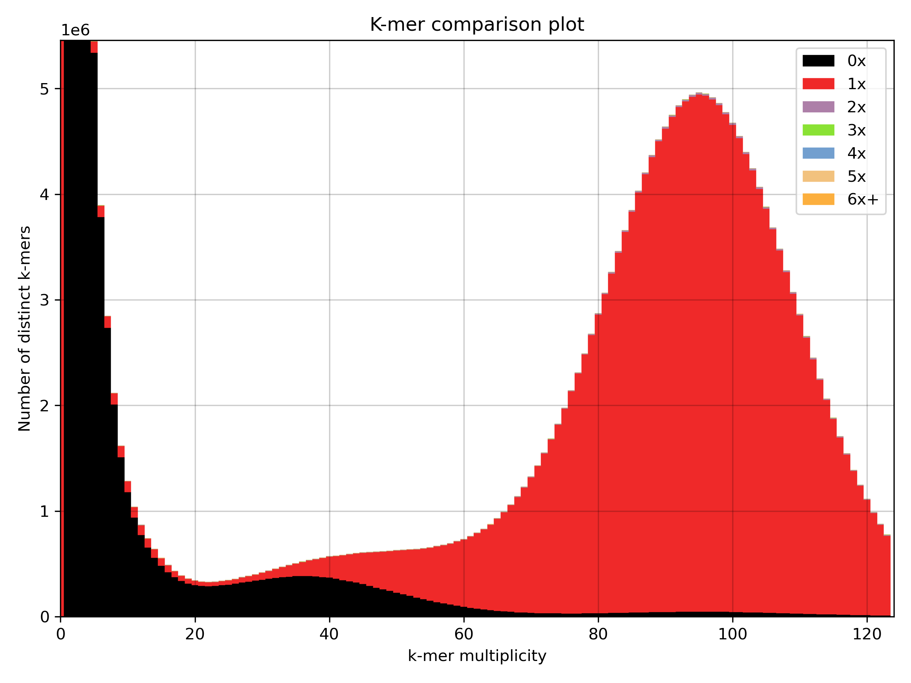
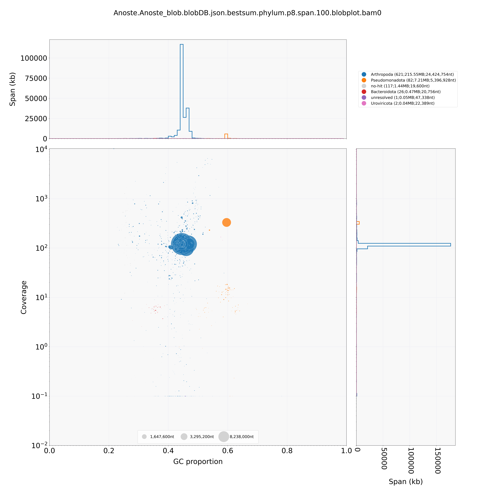

# 03_GenomeAssembly 

## 00_assembly_raw: Get the raw assembly and do a first quality check (BUSCO).

### 1. De novo Assembly
The raw draft assembly (`Anoste_raw.fasta`) was generated from PacBio long reads (`SRR11672506.fastq.gz`) inside a `tmux` session using the `assembly` Conda environment (with wtdbg2):

```bash
mkdir -p ~/Lab_Gen_Comparata/03_GenomeAssembly/00_assembly_raw
cd ~/Lab_Gen_Comparata/03_GenomeAssembly/00_assembly_raw

# Link PacBio long reads
ln -s /home/PERSONALE/mirko.martini3/Lab_CompGeno/00_practice/00_data/00_reads/SRR11672506.fastq.gz .

# Activate assembly environment
conda activate assembly

# Step 1: Assemble long reads into contig layouts
wtdbg2 -x rs -g 227m -t 8 -i SRR11672506.fastq.gz -fo Anoste_raw

# Step 2: Generate the consensus FASTA sequence from the layout file
wtpoa-cns -t 8 -i Anoste_raw.ctg.lay.gz -fo Anoste_raw.fasta
```
Parameter Breakdown (wtdbg2 & wtpoa-cns)
-x rs: Sequencing technology preset (PacBio RSII / long reads).
-g 227m: Expected haploid genome size (~227 Mbp, estimated in the k-mer survey).
-t 8: Number of CPU threads.
-i: Input file (SRR11672506.fastq.gz for wtdbg2; the generated .ctg.lay.gz layout file for wtpoa-cns).
-fo: Output prefix / output FASTA file (Anoste_raw.fasta).

(Note: Since I missed the 19/10 lession, I copied the pre-assembled Anoste_raw.fasta file to continue with the downstream steps).

### Copy the Raw Assembly File
Copy the pre-assembled `Anoste_raw.fasta` file from a classmate's directory into the working folder:

```bash
cp /home/STUDENTI/virginia.piccinotti/Anoste_raw.fasta ~/Lab_Gen_Comparata/03_GenomeAssembly/00_assembly_raw/
```

### Initial Quality Check (BUSCO)
We evaluate the completeness of the raw assembly by searching for conserved single-copy orthologs using **BUSCO**. We used two lineage databases in class (`diptera_odb12` and `culicidae_odb12`); I used `diptera_odb12` (which covers a broader taxonomic group across all flies/mosquitoes).

```bash
# Activate the Conda environment containing BUSCO
conda activate sequence

# Check command syntax if needed
# busco --help | less

# Set max threads and run BUSCO in genome mode (-m geno)
export NUMEXPR_MAX_THREADS=80
busco -m geno -l $BUSCO/diptera_odb12 -c 8 -o Anoste_raw -i Anoste_raw.fasta

git add Anoste_raw/short_summary.specific.diptera_odb12.Anoste_raw.txt
git pull
git commit -m "QC BUSCO on raw assembly"
git push
```

Parameter Breakdown
* -m geno: Genome mode (searches for conserved genes directly in the assembly).
* -l $BUSCO/diptera_odb12: Lineage dataset ($BUSCO is a position of the computer (a variable) placeholder).
* -c 8: Uses 8 CPU threads.
* -o Anoste_raw: Output directory name.
* -i Anoste_raw.fasta: Input raw assembly FASTA file.

safe the file BUSCO: 
git add short_summary.specific.diptera_odb12.Anoste_raw.txt
git pull
git commit -m "QC BUSCO on raw assembly" (-m messaggio)
git push

 
## 01_polishing: Map short and long reads (minimap2 + samtools in mapping.sh), calculate coverage (mosdepth), polish the assembly (hypo) and check the quality again (BUSCO & KAT).
Long-read assemblies often contain small base-level errors (especially indels). We polish the raw assembly using **hypo**, which combines accurate Illumina short reads with PacBio long reads to improve base accuracy (qualitative improvement).

### Read Mapping & Creating a Bash Script (`mapping.sh`)

#### Key Concepts & Workflow
* **Read Mapping:** Aligns sequencing reads onto `Anoste_raw.fasta` so hypo can detect and correct base errors.
* **SAM vs. BAM:** `minimap2` outputs alignments in SAM format (plain text, very large). `samtools` converts it into compressed binary BAM format, sorts it, and creates an index (`.bai`).
* **Bash Scripting (`mapping.sh`):** Starts with #!/bin/bash (shebang) and uses positional arguments ($1, $2, ...) so the script remains reusable.


#### Setup & Script
Create the working directory, link the required input files, and write a reusable Bash script (`mapping.sh`) to align both short and long reads against `Anoste_raw.fasta` using `minimap2` and `samtools`:

```bash
mkdir -p ~/Lab_Gen_Comparata/03_GenomeAssembly/01_polishing
cd ~/Lab_Gen_Comparata/03_GenomeAssembly/01_polishing

# Link raw assembly, short reads (relative paths), and long reads (absolute path)
ln -s ../00_assembly_raw/Anoste_raw.fasta .
ln -s ../../02_KmerBased_GenomeSurvey/SRR11672503_1_paired.fastq .
ln -s ../../02_KmerBased_GenomeSurvey/SRR11672503_2_paired.fastq .
ln -s /home/PERSONALE/mirko.martini3/Lab_CompGeno/00_practice/00_data/00_reads/SRR11672506.fastq.gz .
```

Create the script using `nano mapping.sh` (save with `Ctrl + s`, exit with `Ctrl + x`) and verify its content with `cat mapping.sh`, `head mapping.sh`, or `less mapping.sh` (exit qith q):

```bash
#!/bin/bash

# Mapping short reads on assembly
CPU=$1
INPUT=$2
SR_1=$3
SR_2=$4
PREFIX=$5
LR=$6

# Mapping short reads with minimap2 (-ax sr: short reads)
minimap2 -ax sr --MD -t "$CPU" "$INPUT" "$SR_1" "$SR_2" > "$PREFIX"_sr.sam

# Conversion SAM into BAM
samtools view -b "$PREFIX"_sr.sam > "$PREFIX"_sr.bam
rm "$PREFIX"_sr.sam

# Sorting and indexing of BAM file
samtools sort -@"$CPU" -o "$PREFIX"_sr_sorted.bam "$PREFIX"_sr.bam
samtools index "$PREFIX"_sr_sorted.bam


# Mapping LONG reads (-ax map-pb: long read in one direction)
minimap2 -ax map-pb --MD -t "$CPU" "$INPUT" "$LR" > "$PREFIX"_lr.sam

# conversion SAM into BAM
samtools view -b "$PREFIX"_lr.sam "$PREFIX"_lr.bam
rm "$PREFIX"_lr.sam

# sorting and indexing of BAM file
samtools sort -@"$CPU" -o "$PREFIX"_lr_sorted.bam "$PREFIX"_lr.bam
samtools index "$PREFIX"_lr_sorted.bam
```

Activate the assembly environment and run the script inside the tmux session: 

```bash
conda activate assembly
bash mapping.sh 8 Anoste_raw.fasta SRR11672503_1_paired.fastq SRR11672503_2_paired.fastq Anoste_pol SRR11672506.fastq.gz
```

### Linking Pre-computed BAM Files & Calculating Coverage (`mosdepth`)

#### Disk Space Issue & Symbolic Links
Because running the mapping script for all reads failed due to insufficient space on the server, we linked the pre-computed sorted `.bam` and `.bai` files (along with Mirko's raw assembly) directly from the practice folder to proceed with polishing:

```bash
# Link pre-computed sorted BAM and BAI files
ln -s /home/PERSONALE/mirko.martini3/Lab_CompGeno/00_practice/03_GenomeAssembly/01_polishing/Anoste_raw_pb_sorted.bam .
ln -s /home/PERSONALE/mirko.martini3/Lab_CompGeno/00_practice/03_GenomeAssembly/01_polishing/Anoste_raw_pb_sorted.bam.bai .
ln -s /home/PERSONALE/mirko.martini3/Lab_CompGeno/00_practice/03_GenomeAssembly/01_polishing/Anoste_raw_sr_sorted.bam .
ln -s /home/PERSONALE/mirko.martini3/Lab_CompGeno/00_practice/03_GenomeAssembly/01_polishing/Anoste_raw_sr_sorted.bam.bai .

# Link raw assembly
ln -s /home/PERSONALE/mirko.martini3/Lab_CompGeno/00_practice/03_GenomeAssembly/00_assembly_raw/Anoste_raw.fasta .
```
#### Calculating Short-Read Coverage with mosdepth
Before running hypo polishing, we need the average short-read coverage (-c). We compute coverage in 500 bp windows using mosdepth and calculate the mean using awk:

```bash
# Calculate coverage in 500 bp windows
mosdepth -n --fast-mode --by 500 Anoste_PB Anoste_raw_pb_sorted.bam
mosdepth -n --fast-mode --by 500 Anoste_SR Anoste_raw_sr_sorted.bam


# Compute the mean coverage across all windows
zcat Anoste_SR.regions.bed.gz | awk '{sum += $4; count++} END {print sum / count}' > Anoste_SR_coverage.txt
zcat Anoste_PB.regions.bed.gz | awk '{sum += $4; count++} END {print sum / count}' > Anoste_PB_coverage.txt
```

# Parameter & Tool Breakdown (mosdepth)
*-n: Skips generating the coverage file for every single base (saves disk space and time).
*--fast-mode: Speeds up calculation by semplifing the calculation of coverage.
*--by 500: Divides the genome into windows of 500 bp and calculates the average coverage per window.

zcat + awk: Unzips the regions bed file (zcat), sums up the coverage values of column 4 (sum += $4), counts the lines (count++), and calculates the final average (sum / count).

Results: Mean short-read coverage = `136.412` (`-c 136` for HyPo); mean PacBio long-read coverage = `102.621`.


### Polish the Assembly (`hypo`) and Post_Polishing QC (BUSCO + KAT)

Now that we have the alignments (`.bam`), the calculated coverage, and the draft assembly, we can run **hypo** (Hybrid Polishing) to correct base-level errors and indels.

First, we create a text file (`reads.txt`) listing the paths to the paired short reads (using `echo -e` with `\n` for newlines):

```bash
R1="/home/PERSONALE/mirko.martini3/Lab_CompGeno/00_practice/02_KmerBased_GenomeSurvey/SRR11672503_1_paired.fastq"
R2="/home/PERSONALE/mirko.martini3/Lab_CompGeno/00_practice/02_KmerBased_GenomeSurvey/SRR11672503_2_paired.fastq"
echo -e "$R1\n$R2" > reads.txt

# Then we run hypo and rename the output file:

hypo -d Anoste_raw.fasta -r @reads.txt -s 227054799 -c 136 -b Anoste_raw_sr_sorted.bam -B Anoste_raw_pb_sorted.bam -t 8

mv hypo_Anoste_raw.fasta Anoste_pol.fasta
```

Parameter Breakdown (HyPo)
-d: Draft assembly FASTA file (Anoste_raw.fasta)
-r @reads.txt: File listing paths to the paired short reads (prefixed with @)
-s 227054799: Estimated haploid genome size (~227.05 Mbp from GenomeScope)
-c 136: Mean short-read coverage calculated via mosdepth (136.412)
-b: Sorted BAM file for short reads
-B: Sorted BAM file for PacBio long reads
-t 8: Number of CPU threads

#### Post-Polishing: BUSCO and KAT Quality Control
Polishing corrects punctual base errors (base calling), allowing us to recover more complete genes (qualitative improvement). Meanwhile, assembly contiguity (`N50`, contig count) does not change (quantitative metrics remain the same until contigs are joined during scaffolding).  
Because `bbtools` inside BUSCO fails on single-line FASTA files produced by hypo, we first wrap the sequences to 80 characters per line using `fold`:

```bash
# Wrap single-line FASTA sequences to 80 bp per line
fold -w 80 Anoste_pol.fasta > Anoste_pol_multi.fasta
rm Anoste_pol.fasta
mv Anoste_pol_multi.fasta Anoste_pol.fasta

# Run BUSCO on the polished assembly
conda activate sequence
export NUMEXPR_MAX_THREADS=80
busco -m geno -l $BUSCO/diptera_odb12 -c 9 -o Anoste_pol -i Anoste_pol.fasta

# Run KAT k-mer comparison against trimmed short reads
conda activate kat
ln -s /home/PERSONALE/mirko.martini3/Lab_CompGeno/00_practice/02_KmerBased_GenomeSurvey/SRR11672503_1_paired.fastq .
ln -s /home/PERSONALE/mirko.martini3/Lab_CompGeno/00_practice/02_KmerBased_GenomeSurvey/SRR11672503_2_paired.fastq .

kat comp -t 9 -o Anoste_pol_kat 'SRR11672503_1_paired.fastq SRR11672503_2_paired.fastq' Anoste_pol.fasta
```



## 02_contaminants: Find contaminants (BlobTools) and remove non-Arthropoda contigs using grep and awk.
When we sequence a whole mosquito (*Anopheles stephensi*), we also get DNA from bacteria living in its gut or on its skin (for example, *Pseudomonadota* / *Serratia*)[cite: 4, 10]. We use **BlobTools** to check which contigs belong to the mosquito and which ones are bacteria, and then we delete the bacterial contigs.

### 1. Prepare Mapping and Taxonomic Data (Done by Mirko)
*(Note: These two steps take a lot of server time and space, so Mirko ran them for us. I write them down here so anyone can repeat the whole workflow).*

#### Map the short reads back onto the polished assembly (`minimap2` + `samtools`):**
We use a pipe (`|`) to connect two commands directly. This creates a compressed BAM file right away, without saving a huge temporary SAM file:

```bash
minimap2 --secondary=no --MD -ax sr -t 8 Anoste_pol.fasta \ SRR11672503_1_paired.fastq SRR11672503_2_paired.fastq \ | samtools view -Sb - > Anoste_pol.bam
samtools sort -@8 -o Anoste_pol_sorted.bam Anoste_pol.bam
rm Anoste_pol.bam
samtools index Anoste_pol_sorted.bam
```
#### Find out which species each contig comes from (blastn):
We compare every contig against the NCBI database (nt) to see if it matches a mosquito or a bacterium:
```bash
export BLASTDB=/DATABIG/dbs/NCBI/nt

blastn -query Anoste_pol.fasta -db nt \
  -outfmt '6 qseqid staxids bitscore std sscinames sskingdoms stitle' \
  -max_target_seqs 25 -max_hsps 1 -num_threads 8 -evalue 1e-25 \
  -out Anoste_blast.tsv
```
#### Run BlobTools to See the Contaminants
First, we create a new folder, link the big input files, and run blobtools to create a table and plots:
```bash
mkdir -p ~/Lab_Gen_Comparata/03_GenomeAssembly/02_contaminants
cd ~/Lab_Gen_Comparata/03_GenomeAssembly/02_contaminants

# Create shortcuts (links) to the input files
ln -s ../01_polishing/Anoste_pol.fasta .
ln -s /home/PERSONALE/mirko.martini3/Lab_CompGeno/00_practice/03_GenomeAssembly/02_contaminants/Anoste_pol_sorted.bam .
ln -s /home/PERSONALE/mirko.martini3/Lab_CompGeno/00_practice/03_GenomeAssembly/02_contaminants/Anoste_pol_sorted.bam.bai .
ln -s /home/PERSONALE/mirko.martini3/Lab_CompGeno/00_practice/03_GenomeAssembly/02_contaminants/Anoste_blast.tsv .

# Activate the sequence environment and run BlobTools
conda activate sequence
blobtools create -i Anoste_pol.fasta -b Anoste_pol_sorted.bam -t Anoste_blast.tsv -o Anoste_blob
blobtools view -i Anoste_blob.blobDB.json -o Anoste
blobtools plot -i Anoste_blob.blobDB.json -o Anoste
```
# What Each Command Does
- blobtools create: Combines our assembly (-i), the read mapping (-b), and the BLAST species hits (-t) into one JSON file (Anoste_blob.blobDB.json).
- blobtools view: Creates a text table (Anoste.Anoste_blob.blobDB.table.txt) showing the species, GC content, and coverage for each contig.
- blobtools plot: Draws .png graphs so we can visually spot bacterial contigs.



#### Remove Non-Arthropoda Contigs (grep and awk)
Next, we make a list of all contigs that do not belong to Arthropoda (column 6 in the table) and delete them from our FASTA file:

```bash
# Save the names of all non-Arthropoda contigs in a list
grep -v '^#' Anoste.Anoste_blob.blobDB.table.txt | awk '$6 != "Arthropoda" {print $1}' > contaminants_contigs.txt

# Remove those contigs from the FASTA file
awk '{ if ((NR>1)&&($0~/^>/)) { printf("\n%s", $0); } else if (NR==1) { printf("%s", $0); } else { printf("\t%s", $0); } }' Anoste_pol.fasta \
  | grep -w -v -Ff contaminants_contigs.txt - \
  | tr "\t" "\n" > Anoste_pol_nocont.fa
```
# Explanation of the Commands
- grep -v '^#': Ignores the header lines that start with #.
- awk '$6 != "Arthropoda" {print $1}': Looks at column 6 (phylum). If it is not Arthropoda, it prints column 1 (the contig name).
- First awk command: Puts each FASTA header and its DNA sequence on a single line (>header\tsequence) so grep can filter whole sequences easily.
- grep -w -v -Ff contaminants_contigs.txt -:
  - -w: Matches the exact contig name only.
  - -v: Keeps everything except the names in our contaminant list.
  - -F / -f: Reads the exact names directly from contaminants_contigs.txt.
  - -: Reads the data coming from the awk pipe.
- tr "\t" "\n": Turns the tab (\t) back into a new line (\n) so we get a normal FASTA file again.

#### Quality Check After Cleaning (BUSCO)
Finally, we wrap the lines to 80 characters and run BUSCO again to make sure we did not lose any mosquito genes:
```bash
fold -w 80 Anoste_pol_nocont.fa > Anoste_pol_nocont_multi.fa
conda activate sequence
export NUMEXPR_MAX_THREADS=80
busco -m geno -l $BUSCO/diptera_odb12 -c 8 -o Anoste_nocont -i Anoste_pol_nocont_multi.fa
```


| Metric | Anoste_raw (Raw) | Anoste_pol (Polished) | Change / Effect |
| :--- | :--- | :--- | :--- |
| **Complete BUSCOs (C)** | 96.0% (4,863) | **96.5% (4,891)** | **+0.5% (+28 geni)** |
| **Complete & Single-Copy (S)** | 95.2% (4,825) | **95.8% (4,854)** | **+0.6% (+29 geni)** |
| **Complete & Duplicated (D)** | 0.7% (38) | 0.7% (37) | -1 gene |
| **Fragmented BUSCOs (F)** | 0.6% (29) | 0.6% (29) | Invariato (0) |
| **Missing BUSCOs (M)** | 3.5% (175) | **2.9% (147)** | **-0.6% (-28 geni)** |
| **Number of Contig / Scaffold** | 850 | 849 | -1 contig |
| **Total Lenght (bp)** | 224,097,419 | 224,753,923 | +656,504 bp |
| **Contig / Scaffold N50** | 20 Mbp | 20 Mbp | Unchanged (0) |

### Qualitative vs. Quantitative Evaluation
- **Qualitative improvement (BUSCO):** Polishing with **HyPo** fixed single-base errors in the DNA sequence. Because the sequence is now more accurate, BUSCO found **+28 more complete genes** (completeness went up from `96.0%` to `96.5%`, and missing genes dropped from `175` to `147`).
- **Quantitative contiguity (Assembly Stats):** The overall structure of the assembly stayed almost the same (`N50 = 20 Mbp`, `849` vs. `850` contigs). Polishing only fixes errors *inside* existing pieces—it does not connect contigs into larger scaffolds[cite: 2, 12].


## 03_scaffolding: Build chromosome-level scaffolds using a reference genome (RagTag).
After polishing and removing bacterial contaminants, our assembly still consists of many separate pieces (contigs). In the final step of genome assembly, we use **RagTag** to order and orient our contigs into full chromosome-level scaffolds by comparing them against an official NCBI reference genome of *Anopheles stephensi* (`GCF_013141755.1`).

### Setup and Link Input Files
Create the working directory and create symbolic links (`ln -s`) to our cleaned assembly (`Anoste_pol_nocont.fa`) and the NCBI reference genome:

```bash
mkdir -p ~/Lab_Gen_Comparata/03_GenomeAssembly/03_scaffolding
cd ~/Lab_Gen_Comparata/03_GenomeAssembly/03_scaffolding

# Link cleaned assembly and NCBI reference genome
ln -s ../02_contaminants/Anoste_pol_nocont.fa .
ln -s /home/PERSONALE/mirko.martini3/Lab_CompGeno/00_practice/00_data/01_Anoste_reference/GCF_013141755.1_UCI_ANSTEP_V1.0_genomic.fna .
```
### Reference-Based Misassembly Correction & Scaffolding
Activate the assembly environment and run RagTag:
- ragtag.py correct: Checks for structural errors (misassemblies) in our contigs by aligning them to the reference genome and breaks chimeric contigs if needed.
- ragtag.py scaffold: Orders and connects the corrected contigs into chromosome-level scaffolds (inserting N gaps between them).   

```bash
conda activate assembly

# Correct potential misassemblies
ragtag.py correct -t 10 GCF_013141755.1_UCI_ANSTEP_V1.0_genomic.fna Anoste_pol_nocont.fa

# Order and orient contigs into scaffolds
ragtag.py scaffold -C -t 10 -o Anoste_chr GCF_013141755.1_UCI_ANSTEP_V1.0_genomic.fna ragtag_output/ragtag.correct.fasta
```

#### Parameter Breakdown (RagTag)
- -t 10: Number of CPU threads used to speed up alignment.
- -C: Concatenates all unplaced contigs (sequences that did not map to any chromosome) into a single artificial sequence called chr0.
- -o Anoste_chr: Output directory name containing ragtag.scaffold.fasta.   

### Extract the 3 Main Chromosomes
*Anopheles stephensi* has 3 chromosomes (Chromosome X, Chromosome 2, and Chromosome 3). Next, we inspect the scaffold headers and filter out chr0 and small unplaced fragments so that only the 3 true chromosomes remain:

```bash
# Inspect the first 10 scaffold headers
grep ">" Anoste_chr/ragtag.scaffold.fasta | head

# Create a pattern file with nano
nano chromosomes.txt
>NC_050201.1_RagTag
>NC_050202.1_RagTag
>NC_050203.1_RagTag

# Extract the 3 chromosomes (-A1 prints the matching header line plus 1 sequence line below it)
grep -A1 -Ff chromosomes.txt Anoste_chr/ragtag.scaffold.fasta | grep -v "^--$" > Anoste_chr.fasta

# Wrap sequences to 80 characters per line for downstream tools (BUSCO / MAKER)
fold -w 80 Anoste_chr.fasta > Anoste_chr_multi.fasta
mv Anoste_chr_multi.fasta Anoste_chr.fasta
```

### Final Quality Control (BUSCO & KAT)
Finally, we run BUSCO on both the decontaminated assembly (02_contaminants) and the final chromosome-level assembly (Anoste_chr.fasta), and verify k-mer completeness with KAT:

```bash
# BUSCO on chromosome-level assembly
conda activate sequence
export NUMEXPR_MAX_THREADS=80
busco -m geno -l $BUSCO/diptera_odb12 -c 8 -o Anoste_chr_busco -i Anoste_chr.fasta

# KAT k-mer comparison (confirms ~80% homozygosity and that no true genomic k-mers were lost)
conda activate kat
kat comp -t 8 -o Anoste_chr_kat \
  '/home/PERSONALE/mirko.martini3/Lab_CompGeno/00_practice/02_KmerBased_GenomeSurvey/SRR11672503_1_paired.fastq /home/PERSONALE/mirko.martini3/Lab_CompGeno/00_practice/02_KmerBased_GenomeSurvey/SRR11672503_2_paired.fastq' \
  Anoste_chr.fasta
```
